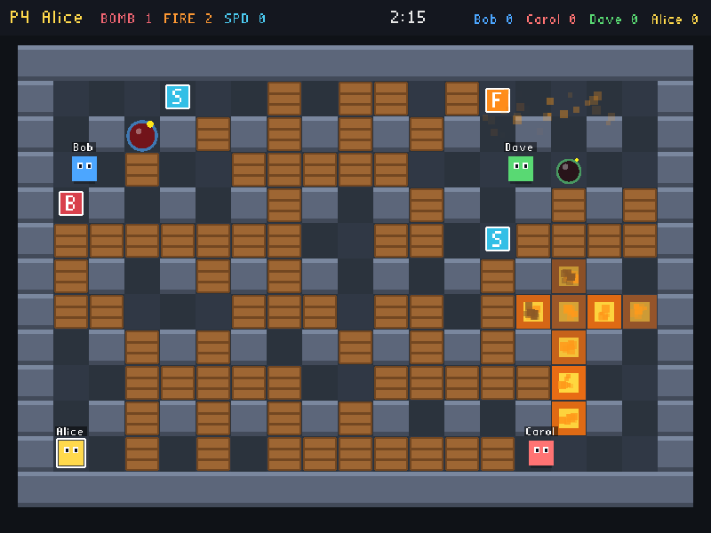
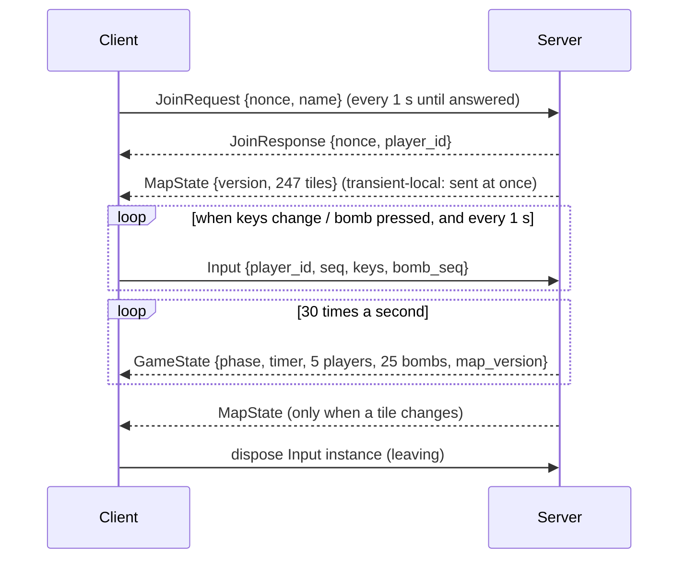

# Blast Arena

A real-time, distributed and secure **Bomberman-style** multiplayer game in C, built on **Cyclone DDS**, **OpenGL** and **GLFW**.
CSD3116 Low-Level Programming team project, extended from the course baseline (`server.c` / `client.c`).



Drop bombs to blast through crates, collect power-ups, and trap the other players. Flames travel in a cross, stop at walls, destroy crates and set off other bombs. **Last player standing wins the round.**

---

## Features

- 2–5 players on a 19×13 tile map, one authoritative server
- Randomly generated maps: indestructible pillars, destructible crates, hidden power-ups (extra bomb, bigger blast, speed)
- Chain reactions, round timer, scores, lobby -> countdown -> playing -> winner
- Smooth movement: 60 Hz server simulation, 30 Hz snapshots, jitter-buffered interpolation on the server's timeline (no rubberbanding)
- Players can **join and leave at any time** (clean exit, crash or network loss)
- **DDS Security**: certificate authentication, encrypted traffic, per-topic access control
- Server rejects inputs that try to control someone else's player (anti-spoofing)
- Unit tests for the game rules and the interpolation (116 checks)

## Requirements

WSL with Ubuntu 22.04 (Cyclone DDS 0.8.2) or 24.04 (Cyclone DDS 0.10.4), or macOS.

```bash
sudo apt update
sudo apt install -y build-essential cmake libgl1-mesa-dev libglfw3-dev \
                    cyclonedds-dev cyclonedds-tools openssl
```

## Build

Tip: copy the project into your Linux home folder first (`cp -r /mnt/c/... ~/blast-arena`). Building on `/mnt/c` works but is much slower.

```bash
cmake -B build
cmake --build build -j
ctest --test-dir build --output-on-failure     # unit tests
```

`messages.h` / `messages.c` are generated from `idl/messages.idl` by CMake (it runs `idlc` for you).

| Program | What it is |
|---|---|
| `build/ba_server` | Game server (start this first) |
| `build/ba_client` | Graphical client, one per player |
| `build/test_game` | Unit tests |

## Run

### Quick start (no security)

```bash
./build/ba_server                       # terminal 1
./build/ba_client --name Alice          # terminal 2
./build/ba_client --name Bob            # terminal 3
```

Or open several players on one machine: `./scripts/play_local.sh 3`

### Secure mode (recommended)

```bash
./security/gen_security.sh 5            # once: CA, certificates, signed XML, configs

./build/ba_server --secure security/out/server.xml
./build/ba_client --secure security/out/client1.xml --name Alice
./build/ba_client --secure security/out/client2.xml --name Bob
```

Each client uses its own identity (`client1` … `client5`). `security/out/` holds private keys and is in `.gitignore`, never commit it.

### Controls

| Key | Action |
|---|---|
| Arrow keys / WASD | Move (hold two keys to turn the next corner) |
| Space / Enter | Drop a bomb |
| Esc | Leave the game |

Click inside the window first so it has keyboard focus.

### Options

| Option | Programs | Meaning |
|---|---|---|
| `--secure FILE` | all | Enable DDS Security with that Cyclone config |
| `--name NAME` | client | Name on the scoreboard (max 15 chars) |
| `--seed N` | server | Fixed random seed (repeatable maps) |
| `-v` | all | Debug logging |

## Game rules

1. A round starts when at least 2 players are connected: a new random map is generated and everyone is placed in a corner (3 s countdown).
2. Each player starts with **1 bomb** and a blast range of **2 tiles**.
3. A bomb explodes after **2.5 s** in a cross of flames. Flames stop at walls, destroy the first crate they hit, and set off any bomb they reach (chain reaction).
4. A player standing in a flame is out.
5. About a third of crates hide a power-up, revealed when the crate is destroyed:
   - **B** – one more bomb at a time (max 5)
   - **F** – one more tile of blast range (max 8)
   - **S** – walk faster (max 4)
   Flames destroy uncollected power-ups.
6. The last player standing wins the round and scores a point. If nobody survives, or the 2:30 timer runs out, it is a draw.
7. Players who join mid-round watch as ghosts until the next round.

## Project layout

```
idl/messages.idl          DDS message types
src/common/               shared by everything
  config.h                all constants (map, timing, gameplay, topic names)
  util.c/.h               monotonic time, random numbers, logging
  dds_setup.c/.h          participant, topics and QoS in one place
src/server/
  game.c/.h               game rules - pure logic, no DDS, unit tested
  server_main.c           threads, DDS message handling, fixed-rate loop
src/client/
  client_net.c/.h         DDS thread: join, send input, receive state and map
  interp.c/.h             snapshot buffer + smoothing on the server timeline
  render.c/.h             OpenGL drawing, effects, HUD
  client_main.c           GLFW window and keyboard
tests/test_game.c         unit tests for game.c
tests/test_interp.c       unit tests + jitter simulation for interp.c
security/gen_security.sh  creates certificates, governance, permissions, configs
scripts/play_local.sh     server + several clients in one command
third_party/stb_easy_font.h  text rendering (public domain, Sean Barrett)
```

## Architecture

### Threads

Both programs keep the baseline's two-thread design, but neither thread busy-waits.

```
SERVER                                    CLIENT
main thread (60 Hz fixed tick)            main thread (vsync)
  sleep until next tick                     read keys -> client_set_keys()
  lock, game_tick(), snapshot, unlock       Space -> client_drop_bomb()
  wake DDS thread (guard condition)         copy latest state (one short lock)
                                            draw (no lock held)
DDS thread (blocks on a WaitSet)          DDS thread (blocks on a WaitSet)
  JoinRequest -> game_join -> reply         JoinResponse (match nonce)
  Input -> verify owner -> apply            MapState / GameState -> buffer
  ready -> write MapState, GameState        input changed / 1 s -> write Input
```

### Messages



| Topic | Direction | QoS | Why |
|---|---|---|---|
| `BA_JoinRequest` | client -> server | reliable, keep last 1, key = nonce | must arrive |
| `BA_JoinResponse` | server -> clients | reliable, keep last 1, key = nonce | each client reads only its own nonce |
| `BA_Input` | client -> server | reliable, keep last 1, key = player_id | only the newest input matters, dispose = leave |
| `BA_GameState` | server -> clients | **best effort**, keep last 1 | a lost snapshot is replaced 33 ms later, resending adds lag |
| `BA_MapState` | server -> clients | reliable, **transient local**, keep last 1 | sent only when a tile changes, late joiners get the current map |

### Smooth movement without rubberbanding

Snapshots leave the server every 33 ms, but network and scheduling jitter make them *arrive* unevenly (15–80 ms apart on WSL). Interpolating by arrival time made players freeze when a snapshot was late and then jump to catch up, which looked like rubberbanding.

`src/client/interp.c` fixes this the way most real-time games do:

1. The client keeps the last 8 snapshots in a ring buffer, each tagged with its **server tick**.
2. It estimates the offset between the server's ticks and its own clock from the fastest arrivals (the lower envelope of the delay), and adjusts that estimate by at most 1 ms per snapshot so corrections are invisible.
3. It draws the world **80 ms in the past** and interpolates between the two snapshots around that moment. A late snapshot is not needed yet, so nothing freezes.
4. Bombs, flames, the map and the HUD are drawn from the **same** delayed snapshot, so a bomb never appears ahead of the player who dropped it.

Measured by `tests/test_interp.c` (simulated walk, 60 fps, random delivery jitter):

| Jitter | Old: freezes | Old: biggest jump | New: freezes | New: biggest jump |
|---|---|---|---|---|
| 0–10 ms | 0 | 2.1× normal step | 0 | 1.0× |
| 0–30 ms | 54 | 3.9× | 0 | 1.06× |
| 0–45 ms | 96 | 5.1× | 0 | 1.12× |

**Bomb presses** are sent as a counter (`bomb_seq`), not a "pressed" flag. With keep-last-1 a quick tap between two messages could be overwritten, a counter can't lose a press, and a repeated message never drops a second bomb.

## Optimisation (compared with the baseline)

| Area | Baseline | Now |
|---|---|---|
| Server main loop | spins with no sleep | `clock_nanosleep` to an absolute deadline, 60 Hz, no drift |
| DDS threads | poll `dds_take` in a loop | block on a DDS **WaitSet**, woken by data or a guard condition |
| Reading | 1 sample per `dds_take` | batches of up to 16 per call, loop until empty |
| Input traffic | 1 message per 10 ms while a key is held, each moves 1 px | keys + bomb counter sent **only on change** + 1 s heartbeat, server moves at a fixed speed |
| State traffic | 1 `Position` message per player | 1 `GameState` for everyone, the map is a **separate topic sent only when it changes** |
| Mutex | held during `dds_write` and a 20 ms sleep, locked once per player per frame | held only for in-memory copies, one lock per frame, never across DDS calls |
| Logging | `printf` for every message | debug logs only with `-v` |
| Rendering | unlimited frame rate | vsync, circle sin/cos precomputed once |
| Message types | n/a | fixed-size arrays and bounded strings: no heap allocation per sample |
| Movement | speed depends on how fast messages arrive | frame-rate independent (tiles per second × dt) |

**Measured** (server only, no window, 2-core Linux VM, Cyclone DDS 0.10.5, release build, no security):

| | Result |
|---|---|
| Baseline server CPU, no players | **198 %** (two threads spinning) |
| New server CPU, no players | **0.3 %** |

The server prints live numbers every 5 s:

```
[stats] players 5 | tick avg 15.8 us max 187.3 us | msgs in 18/s out 33/s (maps 3.4/s) | rejected 0
```

Profiling builds:

```bash
cmake -B build-prof -DBA_PROFILE=ON && cmake --build build-prof   # gprof: run, then `gprof build-prof/ba_server gmon.out`
perf record -g ./build/ba_server                                  # perf
cmake -B build-asan -DBA_SANITIZE=ON -DCMAKE_BUILD_TYPE=Debug     # AddressSanitizer + UBSan
```

## Security

| Threat | Protection |
|---|---|
| Unknown program joins the game | DDS **authentication**: only participants with a certificate signed by our CA are accepted (`allow_unauthenticated_participants=false`) |
| Someone reads the traffic on the network | **Encryption** of discovery, liveliness and all topic data (AES-GCM) |
| A client sends a fake map or game state | **Access control** (signed `permissions.xml`): only the server may publish `BA_GameState`, `BA_MapState` and `BA_JoinResponse`, clients may only publish `BA_JoinRequest` and `BA_Input` |
| A client reads other clients' inputs | Clients are not allowed to subscribe to `BA_Input` / `BA_JoinRequest` |
| A valid client controls **another** player | Server binds each player slot to the DDS participant that joined. Every `Input` writer is checked against it (cached after the first check), mismatches are rejected and logged |
| Tampered governance / permissions files | Both are S/MIME-signed by the CA, Cyclone refuses to start with an invalid signature |
| Malformed messages | Player ids bounds-checked before indexing (the baseline wrote `arr_Players[id-1]` unchecked), unknown key bits rejected, names truncated and made printable |
| Cheating by a modified client | Server-authoritative: clients only send keys, the server decides movement, bombs, explosions and deaths |
| Two clients get the same player id | Random 64-bit nonce from `getrandom()` in each join, replies are matched by nonce |
| Client crashes / disappears | 3 s timeout frees the slot, a clean exit disposes the `Input` instance and frees it at once |

### Security demo (for the video)

```bash
./build/ba_server --secure security/out/server.xml
./build/ba_client --secure security/out/client1.xml --name alice

# No certificate: it never sees the server and never gets a player slot
./build/ba_client --name intruder
```

To show encryption, capture UDP ports 7400–7500 in Wireshark with and without `--secure`. Without it the RTPS packets contain the player names in plain text, with it the payload is unreadable.

To show signing, change one character in `security/out/permissions.p7s` and start the server: it stops with `PKCS7_signatureVerify: digest failure`.

## Testing

| Test | How | Result |
|---|---|---|
| Game rules | `ctest --test-dir build` (13 tests, 99 checks: map, movement, bombs, explosions, chain reactions, power-ups, rounds, timeouts, snapshots) | all pass (checked on Cyclone DDS 0.10.5) |
| Interpolation | `ctest` (17 checks): buffer, reordering, server restart, respawn, and a jitter simulation | no freezes or jumps up to 45 ms jitter |
| Still to do | security demo, sanitizer build, and a real play session with several players | TODO: write down what we saw |

## Troubleshooting

| Problem | Fix |
|---|---|
| `CMakeCache.txt directory ... is different` or `could not create CMAKE_GENERATOR "Visual Studio 17 2022"` | The `build` folder was made by Windows CMake. Delete it inside WSL (`rm -rf build`) and run `cmake -B build` again. |
| `No tests were found` | The build did not run yet, fix the error above first. |
| `./build/ba_server: No such file` | Run it from the project folder, not from inside `build/`. |
| `glfwInit failed` | WSL needs WSLg (Windows 11, `wsl --update`) or an X server for windows to appear. |
| `gen_security.sh` warns `libdds_security_auth.so not found` | Find it with `find / -name 'libdds_security_auth*' 2>/dev/null`. If it does not exist, your Cyclone DDS has no security support: build Cyclone DDS from source with `-DENABLE_SECURITY=ON`. |
| `dds_create_participant` fails with `--secure` | Run `./security/gen_security.sh` again, the paths inside the generated XML must exist on this machine. |

## Known limitations

- No client-side prediction, and the world is drawn 80 ms in the past for smoothness, so your own player reacts about 100 ms after a key press. Fine for a LAN, lower `BA_INTERP_DELAY_MS` in `interp.h` on a very steady network.
- All clients share one CA, in a real deployment each machine would only receive its own private key.
- With security off, everyone on the same LAN and DDS domain 0 can see each other's games.

## Team

| Member | Contributions |
|---|---|
| _Name_ | _Ayob Yantzen_ |
| _Name_ | _Soh Wei Jie_ |

## AI use declaration

Parts of this project were generated with Claude (Anthropic), starting from the course baseline and assignment brief. 

Prompt:
"Draft some ideas for a real-time, interactive, distributed, and secure game for the purpose of code optimization, authentication of clients, and encryption of DDS traffic"

Answer:
"Game ideas for optimization, authentication and encryption
- Blast Arena. Bomberman-style. The server decides everything. Optimization: fixed-rate loop, WaitSets, sending input only on change. Authentication: only certified clients join. Encryption: all topics are encrypted.
- Hot Potato. One player holds a ticking potato and passes it on. It is small, so it is easy to build, but there is less to optimize.
- Tank Arena. Top-down tanks shooting bullets. It has lots of moving objects, so it is a good test for batching state in one message and reducing network traffic.
- Capture the Flag. Two teams on a map. It suits access control well, because each team only gets its own team’s data."

Prompt:
"How should I implement DDS security authentication, encryption, and access control in this project"

Answer:
"Cyclone DDS has three plugins, and this project uses all three:

Authentication: each participant has a certificate signed by your own CA, and the governance file says allow_unauthenticated_participants=false. The identity_ca, identity_certificate and private_key entries in each client XML point to these.
Access control: a signed permissions.xml lists which topics each identity may publish or subscribe to. In your project only the server publishes GameState, MapState and JoinResponse, and clients only publish JoinRequest and Input.
Encryption: the signed governance file turns on encryption of discovery, liveliness and topic data (AES-GCM).

Steps:

Run ./security/gen_security.sh 5. It makes the CA, the certificates, the signed governance and permissions files, and one config XML per identity.
Start each program with --secure security/out/<name>.xml. dds_setup.c passes that config to Cyclone before the participant is created.
Check it works. An intruder with no certificate should never join, and with Wireshark you should not be able to read the names when --secure is on.

Also have the server check that each player slot is used only by the participant that joined it. That is the anti-spoofing check you already have."

Prompt:
"Review my code, and explain how I can mitigate rubberbanding"

Answer:
"Remaining risks and how to reduce them:

Packet loss. GameState is best effort. If several snapshots are lost in a row, the player holds still, then catches up. You could raise the snapshot rate to 60 Hz, or draw a little further in the past.
Fixed 80 ms delay. On a bad network it may be too low. You could grow the delay when jitter is high and shrink it when the network is steady.
No client-side prediction. Your own player reacts about 100 ms after a key press. The standard fix is to move your own player immediately on the client, then correct it gently when the server disagrees. This is the biggest improvement but also the most work.
Corrections. Blend small differences over a few frames instead of snapping. You already snap only for large jumps (respawns), which is right.
Bots and turning. The server only reads keys at tile centres, except the opposite key turns at once. Keep clients from sending a new direction too early."

Prompt:
“Give me the commands for the sanitizer build and what to look for in the output.”

Answer:
"cmake -B build-asan -DBA_SANITIZE=ON -DCMAKE_BUILD_TYPE=Debug
cmake --build build-asan -j
ctest --test-dir build-asan --output-on-failure

export ASAN_OPTIONS=detect_leaks=1:abort_on_error=0
export UBSAN_OPTIONS=print_stacktrace=1
./build-asan/ba_server &
./build-asan/ba_bot --name b1 --seconds 40 &
./build-asan/ba_bot --name b2 --seconds 40 &
./build-asan/ba_client --name You

Stop the server with Ctrl+C so it shuts down cleanly, because leak reports only appear at exit.

What to look for in the output:

Real problems: lines starting ERROR: AddressSanitizer (heap-buffer-overflow, stack-buffer-overflow, use-after-free), and lines containing runtime error: from UBSan.
Leaks: the LeakSanitizer summary at exit. Leaks whose stack is only inside libddsc or OpenGL libraries are usually not yours, so look for frames in src/ or tools/.
Good result: no ERROR: lines and no runtime error: lines."

Prompt:
“Write a checklist of manual play tests for 2 to 5 players, including joining, leaving and crashing a client.”

Answer:
"Start and join

 Start the server, then one client. Expect: lobby, no round yet.
 Join a second client. Expect: 3 second countdown, then play starts.
 Join players 3, 4 and 5 in turn. Expect: each gets a different corner.
 Try a 6th client. Expect: refused, server full.
 Join in the middle of a round. Expect: watch as a ghost until the next round.

Leaving and crashing

 Press Esc in one client mid-round. Expect: others carry on, the slot is freed at once.
 Close a window with the X. Expect: same as above.
 Kill a client (Ctrl+C or Task Manager). Expect: removed after about 3 s.
 Leave until only one player remains. Expect: round ends, back to lobby.
 Restart a client and rejoin. Expect: gets a slot again.
 Stop the server and start it again with clients open. Expect: clients rejoin.

Security (run with --secure)

 Start a client with no certificate. Expect: never joins.
 Capture packets in Wireshark. Expect: names readable without --secure, not with it.

Performance

 Watch the server stats line during a 5-player game. Expect: low CPU and tick time of about 16 us."

## Credits

- Baseline programs: Dr Khoo Teck Ping, DigiPen Institute of Technology Singapore
- Game idea inspired by the classic *Bomberman* series
- [Cyclone DDS](https://github.com/eclipse-cyclonedds/cyclonedds), [GLFW](https://www.glfw.org/)
- [stb_easy_font](https://github.com/nothings/stb) by Sean Barrett (public domain / MIT)
